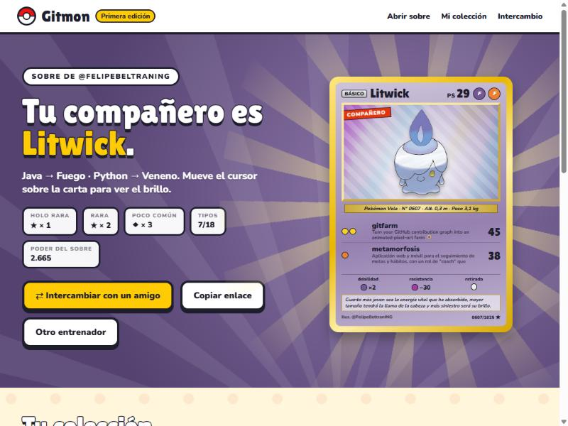
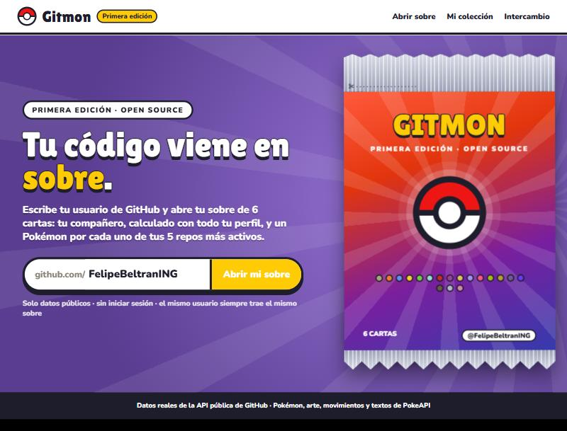
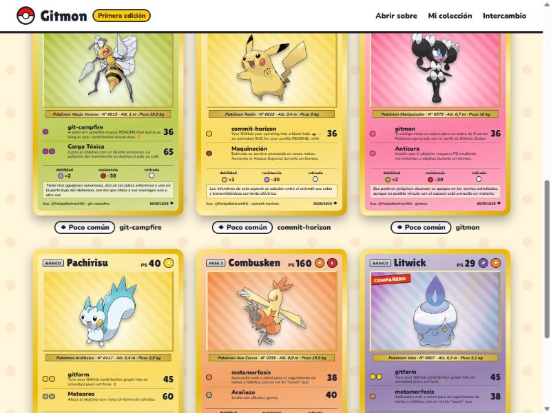

<div align="center">

# Gitmon

**Tu código viene en sobre.**

Escribe tu usuario de GitHub y abre un sobre de 6 cartas Pokémon:
tu **compañero**, calculado con todo tu perfil, y un Pokémon por cada uno de tus **5 repos más activos**.


[](https://github.com/FelipeBeltranING/gitmon/actions/workflows/ci.yml)




</div>

## Cómo se juega

1. **Abre tu sobre.** Escribe tu usuario. El sobre se sacude mientras imprime tus cartas con datos reales de GitHub y de la PokeAPI.
2. **Rásgalo y voltea.** Las cartas salen de menor a mayor rareza; tu compañero siempre va al final, en holo, con su grito real.
3. **Colecciona.** Las 6 cartas quedan en tu álbum con su rareza: ● Común · ◆ Poco común · ★ Rara · ★ Holo rara · ✦ Legendaria · ✧ Variocolor (1 de cada 4096).
4. **Intercambia.** Abre el sobre de alguien a quien sigues en GitHub, compara el poder de los sobres y mira qué carta le cambiarías.

| Sobre | Colección |
|---|---|
|  |  |

## Cómo se elige cada carta

- **Tipo**: tu lenguaje principal (por tamaño y estrellas, sin forks). Java → Fuego, Python → Veneno, JavaScript → Eléctrico, TypeScript → Psíquico… El segundo tipo sale de tu segundo lenguaje, o es **Siniestro** si programas de noche (22:00–05:00) en al menos 3 días distintos.
- **Stats**: seis señales de tu perfil (repos × años, commits, forks, estrellas, seguidores y días activos) en escala logarítmica de 10 a 160.
- **Pokémon**: de la PokeAPI salen los Pokémon de tu tipo; gana el que más se parece en *forma* a tus stats (similitud coseno) sin pasarse de tu etapa.
- **Ataques**: tus repos con más estrellas (daño = 30 + 6·√estrellas) y un movimiento real del Pokémon, en español.
- **Edición**: una semilla global decide qué Pokémon de tu tipo te toca. Mismo usuario + misma edición = mismo sobre, siempre.

El detalle completo, con fórmulas, está en [docs/algoritmo.md](docs/algoritmo.md).

## Desarrollo

```bash
npm install
npm run dev        # http://localhost:5173
npm test           # pruebas del núcleo con Vitest
npm run build      # tipos + build de producción en dist/
```

Prueba otra semilla con `?t=4` y abre directamente un sobre con `/u/<usuario>`.

### Variables de entorno

| Variable | Para qué |
|---|---|
| `GITHUB_TOKEN` | Opcional. Token de solo lectura para la función `/api/github`, que junta perfil, repos, eventos y amigos en una respuesta con caché de 24 h. Sin token, el navegador consulta GitHub directamente (60 consultas/hora por IP). |

## Despliegue en Vercel

1. Importa el repo en Vercel (detecta Vite solo).
2. Añade `GITHUB_TOKEN` en *Settings → Environment Variables*.
3. Despliega. `/u/<usuario>` funciona gracias al rewrite de `vercel.json`.

## Estructura

```
api/github.ts        función serverless: GitHub con token y caché de 24 h
src/core/            algoritmo puro y probado: tipos, stats, rareza, elección, sobre
src/data/            clientes de GitHub y PokeAPI con caché en memoria
src/ui/              carta, sobre, colección e intercambio
src/styles/          estilos por pieza
docs/                concepto, bocetos, decisiones (ADR) y capturas
```

## Historia del diseño

- [Concepto v0](docs/concepto-v0.md) y sus [bocetos originales](docs/bocetos/v0/).
- [Bocetos v1](docs/bocetos/v1/): tres direcciones pokemaníacas (Pokédex, Combate, Carta holo), un híbrido y el sobre final.
- Decisiones: [0001 · Carta coleccionable](docs/adr/0001-direccion-carta.md) · [0002 · Ediciones con semilla global](docs/adr/0002-temporadas.md) · [0003 · Ritmo por días](docs/adr/0003-ritmo-por-dias.md).

## Créditos

Hecho por [@FelipeBeltranING](https://github.com/FelipeBeltranING).
Datos y arte de [PokeAPI](https://pokeapi.co) y de la API pública de GitHub.

Gitmon es un proyecto fan sin ánimo de lucro. Pokémon y los nombres asociados son marcas de Nintendo, Creatures Inc. y GAME FREAK. Este proyecto no está afiliado ni respaldado por ellos.
